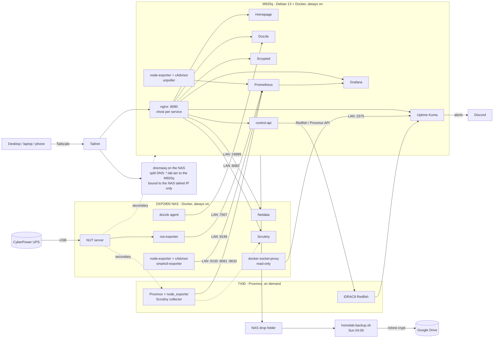
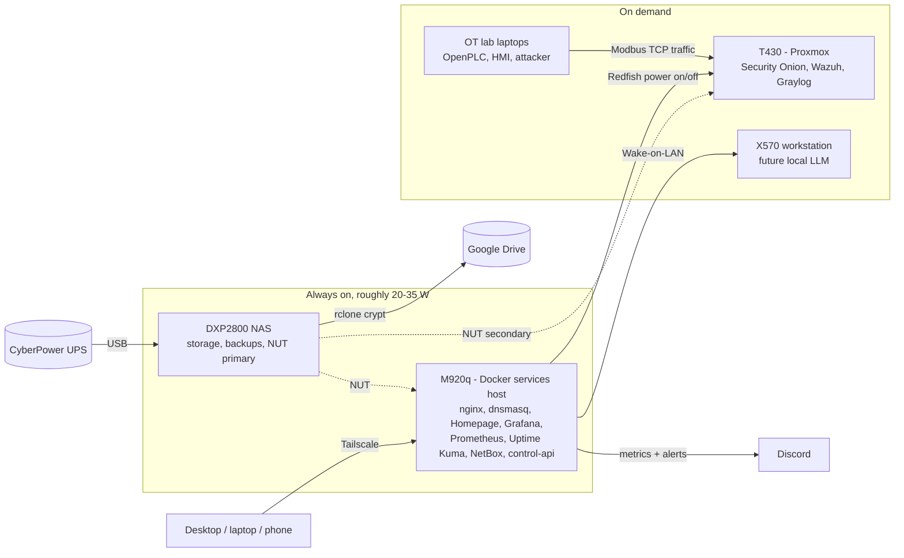

# Homelab: monitored, backed-up, tailnet-only

A homelab split into power tiers: an always-on core of a **Lenovo M920q** (Docker services: dashboards, monitoring, reverse proxy) and a **UGREEN DXP2800 NAS** (storage, backups, UPS, DNS), plus a **Dell PowerEdge T430** running Proxmox that only runs on demand (see [Power-tiered layout](#power-tiered-layout)). Everything is reached over **Tailscale**; nothing is exposed to the internet.

I built this to practice the unglamorous parts of running infrastructure: monitoring that actually alerts, backups that are encrypted *and* verified, least-privilege service accounts, and a documented restore path. My focus is ICS/SCADA security, so the design leans on ideas that carry over to OT: out-of-band management, a sensor-to-alarm-to-action loop for power loss, and minimal exposure by default.

> This repo is a sanitized export. Secrets live in `.env` (see `.env.example`), IPs on the tailnet are replaced with placeholders, and two services (`control-api`, `kuma-seed`) have their source omitted.

## Hardware

| Role | Hardware | Notes |
|---|---|---|
| Services host | Lenovo ThinkCentre M920q Tiny (i5-8600T, 32 GB, 1 TB NVMe), Debian 13 | Always on. Runs the user-facing stack: nginx, Homepage, Grafana, Prometheus, Uptime Kuma, Dozzle, Scrypted, control-api |
| NAS | UGREEN DXP2800 (Intel N100), UGOS (Debian 12 base) | Always on. One 4 TB WD Red Plus (`/volume1`); keeps NUT, split DNS, drive health and the exporters that report on its own hardware |
| Hypervisor | Dell PowerEdge T430 (2x Xeon E5-2630 v3), Proxmox VE | On demand. iDRAC8 (shared LOM) for out-of-band control; PERC H730 with SSD RAID 6 volumes and a separate HDD volume; 96 GB RAM |
| Workstation | X570 (Ryzen 9 3900X, RTX 4070) | On demand via Wake-on-LAN; motherboard swap pending; future local LLM host |
| OT lab (planned) | Donated laptops | Physical OpenPLC / HMI / attacker segment for the security VMs to watch |
| Network | UniFi Dream Router 7 + Flex 2.5G switch | UniFi data exported to Prometheus via unpoller |
| Power | CyberPower SL700U UPS | USB to the NAS; NAS is the NUT primary, the M920q and Proxmox host are NUT secondaries. NAS, T430 and M920q on battery outlets |
| Cameras | 4x Blink Mini | Bridged to a local live-view dashboard with Scrypted |

## Architecture



Services that report on NAS hardware (UPS, drives, host metrics) stay on the NAS and publish on its LAN address only; everything people open in a browser runs on the M920q. The split lets the NAS's 8 GB of RAM go back to being a storage appliance's.

## Power-tiered layout

The T430 idles at well over 100 W. Only what must stay up runs on the efficient hardware; everything else wakes when I'm actually using it. The always-on tier is live; the on-demand controls are next.



- **Always on:** the M920q runs the services (it idles around 10 W), and the NAS drops back to being a storage appliance.
- **On demand:** Homepage gets Lab Up / Lab Down buttons that call the control API to start and gracefully stop the T430, its VMs and the X570.
- **Measured:** UPS load from NUT is graphed in Grafana, so each tier's power cost is visible.
- **Quiet when off:** Kuma and Prometheus alerts for on-demand hosts are paused during planned shutdowns.

### Roadmap

1. ~~Power both switches from the UPS USB ports to free battery outlets~~
2. ~~Migrate the stack from the NAS to the M920q~~ (done: two compose projects, data volumes moved, NUT secondary and nightly backup added); NetBox next
3. X570 motherboard swap
4. Rebuild the donated laptops as a physical OT segment
5. Local camera viewing (Scrypted)

## Services

| Group | Services | Purpose |
|---|---|---|
| Edge | nginx, dnsmasq, Tailscale, fail2ban | Reverse proxy by hostname; split DNS for `*.lab.lan`; mesh VPN; intrusion banning |
| Monitoring | Prometheus (90 d retention), Grafana, Uptime Kuma, Netdata, cAdvisor, node-exporter, smartctl-exporter, Scrutiny, unpoller | Metrics, dashboards, uptime checks, drive health, UniFi stats |
| Power | NUT server (pinned image), nut-exporter, host-side watcher | UPS telemetry and graceful shutdown |
| Dashboard | Homepage | One front page with live widgets (Prometheus-backed, so tiles keep working when a host is off) |
| Operations | Watchtower (monitor-only), Diun, Dozzle | Update visibility without unattended updates; live container logs |
| Control | control-api | Token-protected start/stop of Proxmox VMs and iDRAC power actions |
| Cameras | Scrypted | Persistent local live view for Blink cameras |

## Design decisions

**Exposure is minimal by default.**
- Kuma, Prometheus and Grafana publish on `127.0.0.1` only and are reached through nginx.
- dnsmasq is bound to the tailnet address only, so `*.lab.lan` resolves for tailnet clients and nobody else. `homelab-dns-guard` recreates it if it starts before `tailscale0` exists at boot.
- Internal services on the M920q (Dozzle, Homepage, control-api and others) publish no host ports at all.
- The NAS-side exporters, Netdata, Scrutiny, the Dozzle agent and a read-only Docker socket proxy publish on the NAS's LAN address only, so the M920q can reach them across hosts.

**Credentials are never in config files.** Compose reads `.env`; Homepage receives them as `HOMEPAGE_VAR_*` variables. The iDRAC account used for read-only monitoring is a dedicated Operator-role account, separate from the admin account used by the control API.

**Backups are encrypted, verified and watched** (`host/homelab-backup.sh`).
- The M920q exports its volumes and stack config nightly to a NAS drop folder (`host/m920q/m920q-backup.sh`), briefly stopping Kuma, Grafana and Scrypted so their databases are consistent. It authenticates with a dedicated SSH key.
- Weekly systemd timer on the NAS; its stack config, the M920q drop folder and every NAS Docker volume (except high-churn metrics caches) are archived.
- Uploaded with rclone `crypt` to Google Drive using my own OAuth client and the `drive.file` scope.
- The script lists the remote to confirm the upload before pruning, keeps the newest 3, and has an `ERR` trap that logs failures.
- A **push monitor in Uptime Kuma** expects a heartbeat every 8 days; a missed backup alerts Discord. `rclone.conf` is deliberately excluded from the archive. See [docs/RESTORE.md](docs/RESTORE.md).

**UPS handling is a small sensor-to-alarm-to-action loop.** NUT's `NOTIFYCMD` writes a flag on `LOWBATT`/`FSD`/`SHUTDOWN`. A host-side systemd service polls the flag every 5 seconds (cron's 1-minute floor wastes too much of a ~2 minute runtime budget), waits 45 seconds so the Proxmox host can shut down first, then powers off the NAS. The M920q runs a stock `upsmon` as a secondary (`host/m920q/upsmon.conf.example`) and shuts itself down on low battery or a forced shutdown from the primary. It has a `DRY_RUN` switch for testing, and clears the flag before acting so a stale value can't cause a boot loop. The NUT image is pinned to an exact version because the USB driver is the one thing here I don't want to change under me.

**Storage health is monitored below the filesystem.** Scrutiny watches the NAS drive and, via `megaraid,N` passthrough, the seven drives behind the T430's PERC controller. A Kuma JSON-query monitor reads the controller's rollup health over Redfish, so a degraded array alerts even if the host OS looks fine.

**Updates are visible, not automatic.** Watchtower runs in monitor-only mode and Diun notifies; I decide when to pull.

## Known gaps and trade-offs

I'd rather list these than pretend they don't exist.

- **Single trust boundary.** nginx vhosts have no authentication; access control is "you are on the tailnet". Next step: Tailscale ACLs with tagged servers, then basic auth on Dozzle/Netdata/Scrutiny.
- **Docker socket exposure.** Kuma, Homepage, Netdata, Dozzle and Diun mount the socket read-only, and Watchtower mounts it read-write. Cross-host access already goes through a read-only socket proxy; local mounts don't yet.
- **LAN-published exporters.** The NAS exporters and socket proxy have no authentication; anything on the LAN can read them. VLAN segmentation would contain that.
- **`:latest` tags** on most images, balanced by monitor-only updates; only NUT is pinned.
- **One data disk in the NAS.** Redundancy comes from the encrypted offsite backup, not RAID.
- **NUT's port (3493) listens on the LAN** so the Proxmox host can act as a secondary.
- The backup script archives `.service` files but not the `.timer`; recreate it from `host/`.

## Layout

```
docker-compose.m920q.yml  # services host stack
docker-compose.nas.yml    # NAS stack (UPS, DNS, drive health, exporters)
.env.example              # variable names only (one .env, shared by both hosts)
nginx/conf.d/             # one vhost per service          (M920q)
prometheus/ grafana/      # scrape config, datasource      (M920q)
homepage-config/          # dashboard tiles and widgets    (M920q)
dnsmasq/ netdata/ nut-server/                            # (NAS)
host/                     # systemd units + scripts on the NAS
host/m920q/               # backup timer + NUT client config for the M920q
docs/RESTORE.md           # rebuild runbook
```

## Running it

Each host gets a copy of the repo as `homelab-bundle` (`/volume1/docker/` on the NAS, `/opt/homelab/` on the M920q) with its own compose file in place. Both pin `name: homelab-bundle`, so volume names match across hosts.

```bash
cp docker-compose.m920q.yml docker-compose.yml           # or docker-compose.nas.yml on the NAS
cp .env.example .env && chmod 600 .env                   # fill in real values
docker compose config -q && docker compose up -d
```

Replace `<NAS_TAILSCALE_IP>` in `docker-compose.nas.yml` and `host/homelab-dns-guard.sh`, and `<M920Q_TAILSCALE_IP>` in `dnsmasq/dnsmasq.conf`. On a fresh Debian host, `mkdir -p /var/log/nginx` first: fail2ban mounts nginx logs inside a read-only `/var/log` and the mount point has to exist. Set a Netdata stream API key (`uuidgen`) in `netdata/stream.conf`.

## What I learned

- Monitoring has to be tested end to end: a green dashboard means nothing until you've seen an alert reach a phone.
- Verify backups by listing what landed, and alert on *absence* of a backup, not just on errors.
- Make dashboards tolerate a host being off; otherwise the first power-down looks like an outage.
- Match component versions across a collector/hub pair (Scrutiny) before debugging anything else.
- Splitting a single compose project across hosts is mostly about names: every container-name reference that now crosses a host boundary has to become an address, and every exporter it points at has to publish a port.
- Copy a database volume only after its writer has stopped and its export has finished; a half-written tarball looks fine until you extract it.
