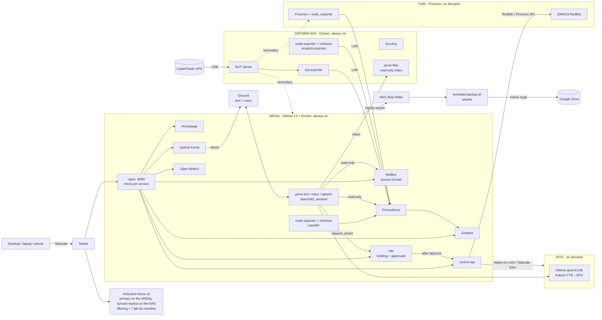

# Homelab: monitored, backed-up, tailnet-only, with a local AI operator

A homelab split into power tiers. The always-on core is a **Lenovo M920q** (Docker services: dashboards, monitoring, reverse proxy, automation) and a **UGREEN DXP2800 NAS** (storage, backups, UPS, DNS). A **Dell PowerEdge T430** (Proxmox) and an **X570 workstation** (GPU) run only on demand. Everything is reached over **Tailscale**; nothing is exposed to the internet.

On top of that sits **Jarvis**, a local AI assistant that knows the lab's inventory, posts a daily briefing, answers by text or voice in Discord, and can power machines on and off, but only after I click Approve. The LLM, speech recognition and speech synthesis all run on lab hardware, with no cloud AI APIs. See [Jarvis](#jarvis-local-ai-operator) below and the full write-up in [docs/JARVIS.md](docs/JARVIS.md).

I built this to practice the unglamorous parts of running infrastructure: monitoring that actually alerts, backups that are encrypted *and* verified, least-privilege service accounts, sequenced power control, and a documented restore path. My background is industrial maintenance and controls, so the design leans on ideas from the plant floor: out-of-band management, a sensor-to-alarm-to-action loop for power loss, permissives before anything changes state, and minimal exposure by default.

> This repo is a sanitized export. Secrets live in `.env` (see `.env.example`), IPs on the tailnet are replaced with placeholders, and two services (`control-api`, `kuma-seed`) have their source omitted.

## Hardware

| Role | Hardware | Notes |
|---|---|---|
| Services host | Lenovo ThinkCentre M920q Tiny (i5-8600T, 32 GB, 1 TB NVMe), Debian 13 | Always on. Runs the user-facing stack and Jarvis: nginx, AdGuard (primary), Homepage, Grafana, Prometheus, Uptime Kuma, NetBox, n8n, Open WebUI, control-api, Jarvis services |
| NAS | UGREEN DXP2800 (Intel N100), UGOS (Debian 12 base) | Always on. One 4 TB WD Red Plus (`/volume1`); keeps NUT, secondary DNS (AdGuard replica), drive health, Jarvis's read-only file index, and the exporters that report on its own hardware |
| Hypervisor | Dell PowerEdge T430 (2x Xeon E5-2630 v3), Proxmox VE | On demand. iDRAC8 (shared LOM) for out-of-band control; PERC H730 with SSD RAID 6 volumes and a separate HDD volume; 96 GB RAM |
| Workstation / AI host | X570 (Crosshair VIII Hero, Ryzen 9 3900X, RTX 4070 SUPER 12 GB), Fedora/Windows dual boot | On demand: Wake-on-LAN from the M920q, poweroff over Tailscale SSH. Runs Ollama (`qwen3:14b`) and Kokoro TTS on the GPU for Jarvis; a Gaming mode releases the GPU |
| Lab nodes (planned) | Donated laptops | To be rebuilt as additional lab nodes |
| Network | UniFi Dream Router 7 + Flex 2.5G switch + Flex Mini | UniFi data exported to Prometheus via unpoller |
| Power | CyberPower SL700U UPS | USB to the NAS; NAS is the NUT primary, the M920q and Proxmox host are NUT secondaries. NAS, T430 and M920q on battery outlets; switches powered from the UPS's USB ports |
| Cameras | 4x Blink Mini | Bridged to a local live-view dashboard with Scrypted |

## Architecture



Services that report on NAS hardware (UPS, drives, host metrics) stay on the NAS and publish on its LAN address only; everything people open in a browser runs on the M920q. The split lets the NAS's 8 GB of RAM go back to being a storage appliance's.

## Power-tiered layout

The T430 idles at well over 100 W and the X570 isn't much better. Only what must stay up runs on the efficient hardware; everything else wakes when it's actually needed, whether by me or by Jarvis.

- **Always on (roughly 20-35 W):** the M920q runs the services (it idles around 10 W), and the NAS is a storage appliance again.
- **On demand:** the X570 wakes by Wake-on-LAN from a Homepage tile or from n8n (it's up at 6:56 for the daily briefing and shut down again afterwards if it was off before). The T430 powers on and shuts down gracefully over iDRAC Redfish.
- **Measured:** UPS load from NUT is graphed in Grafana, so each tier's power cost is visible.
- **Quiet when off:** on-demand hosts are tagged `on-demand` in NetBox, so dashboards, the briefing and the lab scanner treat "off" as normal rather than as an outage.

### Roadmap

1. ~~Power both switches from the UPS USB ports to free battery outlets~~
2. ~~Migrate the stack from the NAS to the M920q~~ (two compose projects, data volumes moved, NUT secondary and nightly backup added)
3. ~~X570 motherboard swap~~ (Win11 + Fedora 45, WoL from Homepage, Prometheus metrics)
4. ~~Redundant DNS: replace dnsmasq with AdGuard Home primary + synced replica~~
5. ~~Jarvis: local LLM, NetBox knowledge base, daily briefing, approval-gated actions, voice, Lockdown~~ ([docs/JARVIS.md](docs/JARVIS.md))
6. Lab Up / Lab Down buttons: one-click sequenced start and graceful stop of the whole lab
7. Offline backup copy: an NVMe on a switched USB hub port, powered only while a backup is written
8. Rebuild the donated laptops as lab nodes
9. Local cameras: replace the Blink Minis with local-RTSP cameras in Scrypted

## Jarvis: local AI operator

Jarvis is a Discord bot backed by a local LLM (Ollama `qwen3:14b` on the X570's RTX 4070 SUPER) with a fixed set of tools:

- **Reads:** Prometheus metrics, NetBox inventory (devices, ports, cabling, IPs), container logs through a GET-only Docker socket proxy, a read-only full-text index of the NAS, weather, headlines and private web search (SearXNG).
- **Daily briefing:** n8n wakes the X570, gathers facts, has the model write a briefing, posts it to Discord, and puts the X570 back the way it found it. A push monitor alerts if a morning run is missed.
- **Voice:** wake word "Jarvis" in a Discord voice channel; faster-whisper for speech-to-text, Kokoro for speech. About 4.3 s from end of speech to start of reply after tuning.
- **Lockdown:** one command tightens the Tailscale policy, turns on stricter AdGuard threat lists, and runs a scan of the lab against a recorded baseline (new clients, machines, open ports, containers, unexpected down targets).

**Guardrails are the point of the design:**

- The model never acts directly. Its only path to changing anything is `request_action`, which posts Approve/Deny buttons; nothing runs until I click Approve.
- Actions are an allowlist (`wake_x570`, `shutdown_x570`, `power_on_t430`, `shutdown_t430`, `lockdown_off`). Destructive power actions (force off, restart) still require a bearer token.
- Lockdown can be turned **on** without approval because it's protective; turning it **off** needs approval.
- Only my Discord user ID is listened to, by text or voice.
- Web content is wrapped as untrusted, and Jarvis is told never to follow instructions in it. `fetch_page` can only reach public IPs, and every redirect is re-checked.
- Log lines are scrubbed of tokens, webhooks and passwords before the model sees them; the file index excludes `.env*`, keys, certs, password databases and SQLite files.
- Everything is logged.

Full architecture, rebuild steps, latency tuning and lessons learned: [docs/JARVIS.md](docs/JARVIS.md).

## Services

| Group | Services | Purpose |
|---|---|---|
| Edge | nginx, AdGuard Home (primary + NAS replica, adguardhome-sync), Tailscale, fail2ban | Reverse proxy by hostname; tailnet-wide DNS filtering and `*.lab.lan` rewrites with failover; mesh VPN (the M920q is also a Tailscale exit node); intrusion banning |
| Monitoring | Prometheus (90 d retention), Grafana, Uptime Kuma, Netdata, cAdvisor, node-exporter, smartctl-exporter, Scrutiny, unpoller | Metrics, dashboards, uptime checks, drive health, UniFi stats |
| Power | NUT server (pinned image), nut-exporter, host-side watcher | UPS telemetry and graceful shutdown |
| Dashboard | Homepage | One front page with live widgets (Prometheus-backed, so tiles keep working when a host is off), plus Wake, Gaming mode and Lockdown tiles |
| Inventory | NetBox | Source of truth for devices, interfaces, cabling and IPs; Jarvis reads it with a read-only token |
| Automation / AI | n8n, Ollama, Open WebUI, jarvis-bot, jarvis-voice, jarvis-speech, Kokoro, SearXNG, jarvis-sentinel, jarvis-files | Daily briefing, approval-gated actions, local LLM chat, Discord text/voice assistant, Lockdown and lab scanning |
| Operations | Watchtower (monitor-only), Diun, Dozzle | Update visibility without unattended updates; live container logs |
| Control | control-api (Flask) | X570 wake/shutdown and Gaming mode; iDRAC power actions and Proxmox VM start/stop; destructive actions token-protected |
| Cameras | Scrypted | Persistent local live view for Blink cameras |

## Design decisions

**Exposure is minimal by default.**
- Kuma, Prometheus and Grafana publish on `127.0.0.1` only and are reached through nginx.
- DNS is two AdGuard Home instances set as Tailscale global nameservers ("Override DNS servers" on): the primary on the M920q and a replica on the NAS kept identical by adguardhome-sync, so DNS and filtering survive either host going down. The NAS instance binds only its tailnet address (UGOS keeps `127.0.0.1:53`); if it starts before `tailscale0` exists the bind fails and Docker's restart policy retries, which replaced the old dnsmasq boot-race guard.
- Internal services on the M920q (Dozzle, Homepage, control-api, the Jarvis APIs, SearXNG and others) publish no host ports at all.
- The tailnet policy is not the default allow-all: my own devices have full access, and the portable device tag is limited to SSH/mosh into three hosts. Lockdown swaps in a stricter policy and restores the saved one exactly.
- The M920q is a Tailscale exit node (forwarding sysctls and UDP GRO tuning in `host/m920q/`), so any tailnet device can send all its traffic home over WireGuard on untrusted networks; the phone normally uses a Mullvad exit node through Tailscale's add-on instead. Either way DNS still goes to the tailnet AdGuard servers.
- The NAS-side exporters, Netdata, Scrutiny, the Dozzle agent and a read-only Docker socket proxy publish on the NAS's LAN address only, so the M920q can reach them across hosts.

**Credentials are never in config files.** Compose reads `.env`; Homepage receives them as `HOMEPAGE_VAR_*` variables. The iDRAC account used for read-only monitoring is a dedicated login-only account, separate from the admin account used by the control API. Jarvis's NetBox token is read-only.

**Backups are encrypted, verified and watched** (`host/homelab-backup.sh`).
- The M920q exports its volumes and stack config nightly to a NAS drop folder (`host/m920q/m920q-backup.sh`), briefly stopping Kuma, Grafana and Scrypted so their databases are consistent. It authenticates with a dedicated SSH key.
- A weekly systemd timer on the NAS archives its stack config, units and timer, the M920q drop folder and every NAS Docker volume (except high-churn metrics caches).
- Uploaded with rclone `crypt` to Google Drive using my own OAuth client and the `drive.file` scope.
- The script lists the remote to confirm the upload before pruning, keeps the newest 3, and has an `ERR` trap that logs failures.
- A **push monitor in Uptime Kuma** expects a heartbeat every 8 days; a missed backup alerts Discord. `rclone.conf` is deliberately excluded from the archive. See [docs/RESTORE.md](docs/RESTORE.md).

**UPS handling is a small sensor-to-alarm-to-action loop.** NUT's `NOTIFYCMD` writes a flag on `LOWBATT`/`FSD`/`SHUTDOWN`. A host-side systemd service polls the flag every 5 seconds (cron's 1-minute floor wastes too much of a ~2 minute runtime budget), waits 45 seconds so the Proxmox host can shut down first, then powers off the NAS. The M920q runs a stock `upsmon` as a secondary (`host/m920q/upsmon.conf.example`) and shuts itself down on low battery or a forced shutdown from the primary. It has a `DRY_RUN` switch for testing, and clears the flag before acting so a stale value can't cause a boot loop. The NUT image is pinned to an exact version because the USB driver is the one thing here I don't want to change under me.

**Storage health is monitored below the filesystem.** Scrutiny watches the NAS drive and, via `megaraid,N` passthrough, the seven drives behind the T430's PERC controller. A Kuma JSON-query monitor reads the controller's rollup health over Redfish, so a degraded array alerts even if the host OS looks fine.

**Updates are visible, not automatic.** Watchtower runs in monitor-only mode and Diun notifies; I decide when to pull.

**Automation asks before it acts.** Jarvis and n8n can read almost anything in the lab but can change only what's on an allowlist, and only after a human approval. Protective actions (Lockdown on) are the one exception.

## Engineering parallels

The patterns here are the same ones used on production equipment, at a smaller scale:

- **Sequenced shutdown:** the UPS loop shuts hosts down in a fixed order with timed waits, like a controlled line stop.
- **Permissives and interlocks:** every state-changing action needs an explicit Approve, and destructive actions need a second credential.
- **Alarm management:** alerts go to one place, planned-off equipment is suppressed instead of alarming, and a missing heartbeat is itself an alarm.
- **Condition monitoring:** SMART data, controller health and UPS load are trended so failures show up before they become downtime.

## Known gaps and trade-offs

I'd rather list these than pretend they don't exist.

- **Weak trust boundary inside the tailnet.** The tailnet policy restricts the portable device, but nginx vhosts have no authentication for my own devices; access control is mostly "you are on my devices". Next step: tagged servers in the policy, then basic auth on Dozzle/Netdata/Scrutiny.
- **Docker socket exposure.** Kuma, Homepage, Netdata, Dozzle and Diun mount the socket read-only, and Watchtower mounts it read-write. Cross-host access and Jarvis's log access go through read-only socket proxies; local mounts don't yet.
- **LAN-published exporters.** The NAS exporters and socket proxy have no authentication; anything on the LAN can read them. VLAN segmentation would contain that.
- **`:latest` tags** on most images, balanced by monitor-only updates; only NUT is pinned.
- **One data disk in the NAS.** Redundancy comes from the encrypted offsite backup, not RAID. An offline local copy is on the roadmap.
- **NUT's port (3493) is published on the NAS LAN address** so the Proxmox host and M920q can act as secondaries.
- **Jarvis depends on an on-demand host.** If the X570 doesn't wake, Jarvis can't think; the briefing's missed-run monitor catches it, but there's no CPU fallback model yet. Gaming mode deliberately takes the GPU away.
- **Jarvis's answers pass through Discord.** The models are local, but questions, replies and any file contents Jarvis quotes go through Discord's servers.

## Layout

```
docker-compose.m920q.yml           # services host stack
docker-compose.m920q.override.yml  # Jarvis, n8n, Open WebUI, SearXNG and related services (M920q)
docker-compose.nas.yml             # NAS stack (UPS, DNS, drive health, exporters, jarvis-files)
.env.example                       # variable names only (one .env, shared by both hosts)
nginx/conf.d/                      # one vhost per service          (M920q)
prometheus/ grafana/               # scrape config, datasource      (M920q)
homepage-config/                   # dashboard tiles and widgets    (M920q)
n8n/                               # exported workflows (briefing, actions)
netbox/                            # netbox-docker override
jarvis-*/                          # Jarvis bot, voice, speech, sentinel, files
netdata/ nut-server/ adguard/      # (NAS; adguard/ also on the M920q, runtime data, not committed)
host/                              # systemd units + scripts on the NAS
host/m920q/                        # backup timer, NUT client config, exit-node tuning
host/x570/                         # Ollama, Kokoro GPU and firewall setup for the X570
docs/JARVIS.md                     # Jarvis architecture, guardrails, rebuild
docs/RESTORE.md                    # rebuild runbook
```

## Running it

Each host gets a copy of the repo as `homelab-bundle` (`/volume1/docker/` on the NAS, `/opt/homelab/` on the M920q) with its own compose file in place. Both pin `name: homelab-bundle`, so volume names match across hosts.

```bash
cp docker-compose.m920q.yml docker-compose.yml           # or docker-compose.nas.yml on the NAS
cp docker-compose.m920q.override.yml docker-compose.override.yml   # M920q only, for Jarvis
cp .env.example .env && chmod 600 .env                   # fill in real values
docker compose config -q && docker compose up -d
```

Run AdGuard's first-run wizard on each host (M920q: temporarily map `3010:3000`; NAS: `:3000`, DNS bound to the NAS tailnet IP, admin on `:8086`), use the same admin login on both, then add the `*.lab.lan` rewrite on the primary only - adguardhome-sync copies it. On a fresh Debian host, `mkdir -p /var/log/nginx` first: fail2ban mounts nginx logs inside a read-only `/var/log` and the mount point has to exist. Set a Netdata stream API key (`uuidgen`) in `netdata/stream.conf`. For Jarvis (NetBox, n8n, Discord bot, X570), follow the rebuild steps in [docs/JARVIS.md](docs/JARVIS.md#rebuild).

## What I learned

- Monitoring has to be tested end to end: a green dashboard means nothing until you've seen an alert reach a phone.
- Verify backups by listing what landed, and alert on *absence* of a backup, not just on errors.
- Make dashboards tolerate a host being off; otherwise the first power-down looks like an outage.
- Match component versions across a collector/hub pair (Scrutiny) before debugging anything else.
- Splitting a single compose project across hosts is mostly about names: every container-name reference that now crosses a host boundary has to become an address, and every exporter it points at has to publish a port.
- Copy a database volume only after its writer has stopped and its export has finished; a half-written tarball looks fine until you extract it.
- An LLM with tools is only as safe as the narrowest path it has to the real world. Giving it one "request" tool and a human approval step was simpler and more trustworthy than trying to make the model itself reliable.
- An inventory system (NetBox) pays for itself the moment something else has to reason about the lab: "off" stops looking like "down" once the source of truth says which machines are on-demand.
