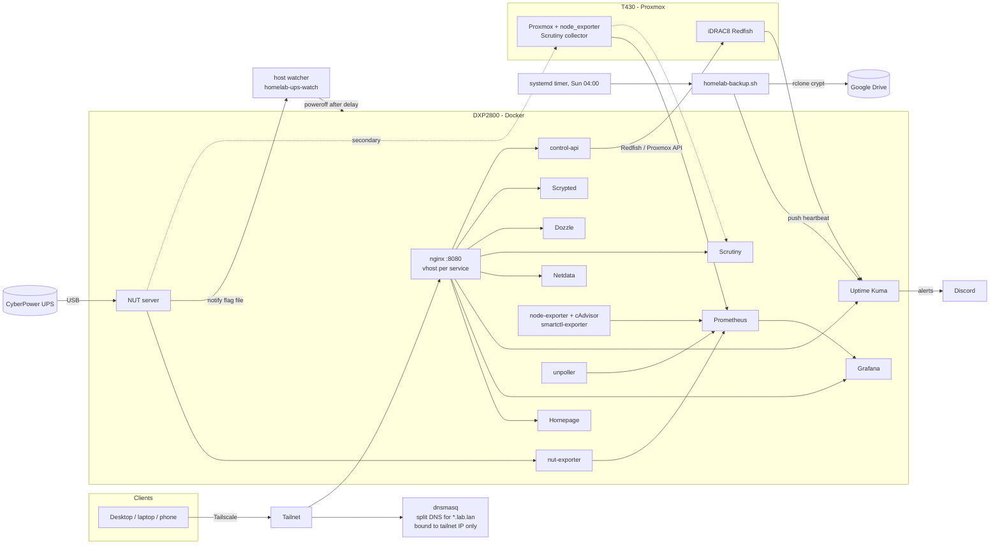
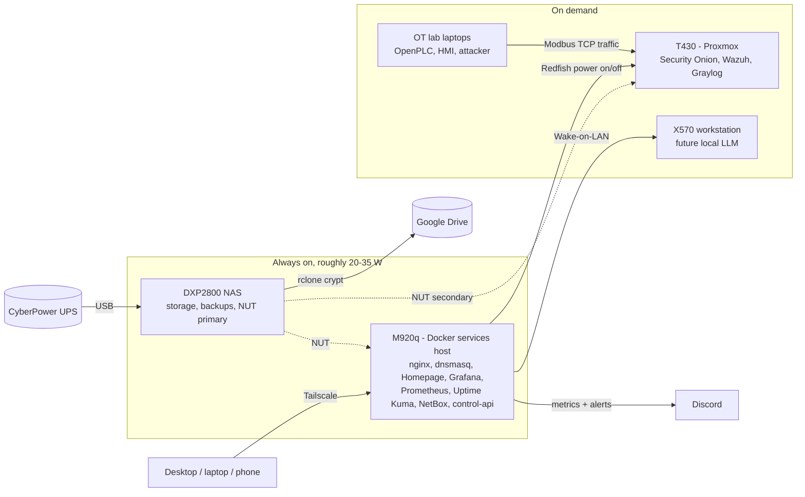

# Homelab: monitored, backed-up, tailnet-only

A homelab built around a **UGREEN DXP2800 NAS** (Docker stack, monitoring, UPS handling, DNS) and a **Dell PowerEdge T430** running Proxmox, now being reorganized into power tiers: a small always-on core and big machines that run only on demand (see [Where it's going](#where-its-going-power-tiered-layout)). Everything is reached over **Tailscale**; nothing is exposed to the internet.

I built this to practice the unglamorous parts of running infrastructure: monitoring that actually alerts, backups that are encrypted *and* verified, least-privilege service accounts, and a documented restore path. My focus is ICS/SCADA security, so the design leans on ideas that carry over to OT: out-of-band management, a sensor-to-alarm-to-action loop for power loss, and minimal exposure by default.

> This repo is a sanitized export. Secrets live in `.env` (see `.env.example`), IPs on the tailnet are replaced with placeholders, and two services (`control-api`, `kuma-seed`) have their source omitted.

## Hardware

| Role | Hardware | Notes |
|---|---|---|
| NAS / Docker host | UGREEN DXP2800 (Intel N100), UGOS (Debian 12 base) | One 4 TB WD Red Plus (`/volume1`); system on eMMC |
| Services host (migration in progress) | Lenovo ThinkCentre M920q Tiny (i5-8600T, 32 GB, 1 TB NVMe) | Always-on Docker host taking over the stack from the NAS, plus NetBox |
| Hypervisor | Dell PowerEdge T430 (2x Xeon E5-2630 v3), Proxmox VE | On demand. iDRAC8 (shared LOM) for out-of-band control; PERC H730 with SSD RAID 6 volumes and a separate HDD volume; RAM going from 32 GB to 96 GB |
| Workstation | X570 (Ryzen 9 3900X, RTX 4070) | On demand via Wake-on-LAN; motherboard swap pending; future local LLM host |
| OT lab (planned) | Donated laptops | Physical OpenPLC / HMI / attacker segment for the security VMs to watch |
| Network | UniFi Dream Router 7 + Flex 2.5G switch | UniFi data exported to Prometheus via unpoller |
| Power | CyberPower SL700U UPS | USB to the NAS; NAS is the NUT primary, Proxmox host is a NUT secondary. Planned: NAS, T430 and M920q on battery outlets; switches powered from the UPS USB ports |
| Cameras | 4x Blink Mini | Bridged to a local live-view dashboard with Scrypted |

## Architecture



## Where it's going: power-tiered layout

The NAS's 8 GB of RAM is full, and the T430 idles at well over 100 W. The plan is to keep only what must stay up on the most efficient hardware, and wake everything else when I'm actually using it.



- **Always on:** the M920q runs the services (it idles around 10 W), and the NAS drops back to being a storage appliance.
- **On demand:** Homepage gets Lab Up / Lab Down buttons that call the control API to start and gracefully stop the T430, its VMs and the X570.
- **Measured:** UPS load from NUT is graphed in Grafana, so each tier's power cost is visible.
- **Quiet when off:** Kuma and Prometheus alerts for on-demand hosts are paused during planned shutdowns.

### Roadmap

1. Power both switches from the UPS USB ports to free battery outlets
2. Migrate the stack from the NAS to the M920q (in parallel: install the T430 RAM upgrade)
3. X570 motherboard swap
4. Rebuild the donated laptops as a physical OT segment
5. Local camera viewing (Scrypted)

## Services

| Group | Services | Purpose |
|---|---|---|
| Edge | nginx, dnsmasq, Tailscale, fail2ban | Reverse proxy by hostname; split DNS for `*.lab.lan`; mesh VPN; intrusion banning |
| Monitoring | Prometheus (90 d retention), Grafana, Uptime Kuma, Netdata, cAdvisor, node-exporter, smartctl-exporter, Scrutiny, unpoller | Metrics, dashboards, uptime checks, drive health, UniFi stats |
| Power | NUT server (pinned image), nut-exporter, host-side watcher | UPS telemetry and graceful shutdown |
| Dashboard | Homepage | One front page with live widgets (Prometheus-backed, so tiles keep working when a host is off) |
| Operations | Watchtower (monitor-only), Diun, Dozzle | Update visibility without unattended updates; live container logs |
| Control | control-api | Token-protected start/stop of Proxmox VMs and iDRAC power actions |
| Cameras | Scrypted | Persistent local live view for Blink cameras |

## Design decisions

**Exposure is minimal by default.**
- Kuma, Prometheus and Grafana publish on `127.0.0.1` only and are reached through nginx.
- dnsmasq is bound to the tailnet address only, so `*.lab.lan` resolves for tailnet clients and nobody else. `homelab-dns-guard` recreates it if it starts before `tailscale0` exists at boot.
- Internal services (Dozzle, Netdata, Scrutiny, Homepage and others) publish no host ports at all.

**Credentials are never in config files.** Compose reads `.env`; Homepage receives them as `HOMEPAGE_VAR_*` variables. The iDRAC account used for read-only monitoring is a dedicated Operator-role account, separate from the admin account used by the control API.

**Backups are encrypted, verified and watched** (`host/homelab-backup.sh`).
- Weekly systemd timer; stack config plus every Docker volume (except high-churn metrics caches) is archived.
- Uploaded with rclone `crypt` to Google Drive using my own OAuth client and the `drive.file` scope.
- The script lists the remote to confirm the upload before pruning, keeps the newest 3, and has an `ERR` trap that logs failures.
- A **push monitor in Uptime Kuma** expects a heartbeat every 8 days; a missed backup alerts Discord. `rclone.conf` is deliberately excluded from the archive. See [docs/RESTORE.md](docs/RESTORE.md).

**UPS handling is a small sensor-to-alarm-to-action loop.** NUT's `NOTIFYCMD` writes a flag on `LOWBATT`/`FSD`/`SHUTDOWN`. A host-side systemd service polls the flag every 5 seconds (cron's 1-minute floor wastes too much of a ~2 minute runtime budget), waits 45 seconds so the Proxmox host can shut down first, then powers off the NAS. It has a `DRY_RUN` switch for testing, and clears the flag before acting so a stale value can't cause a boot loop. The NUT image is pinned to an exact version because the USB driver is the one thing here I don't want to change under me.

**Storage health is monitored below the filesystem.** Scrutiny watches the NAS drive and, via `megaraid,N` passthrough, the seven drives behind the T430's PERC controller. A Kuma JSON-query monitor reads the controller's rollup health over Redfish, so a degraded array alerts even if the host OS looks fine.

**Updates are visible, not automatic.** Watchtower runs in monitor-only mode and Diun notifies; I decide when to pull.

## Known gaps and trade-offs

I'd rather list these than pretend they don't exist.

- **Single trust boundary.** nginx vhosts have no authentication; access control is "you are on the tailnet". Next step: Tailscale ACLs with tagged servers, then basic auth on Dozzle/Netdata/Scrutiny.
- **Docker socket exposure.** Kuma, Homepage, Netdata, Dozzle and Diun mount the socket read-only, and Watchtower mounts it read-write. A socket proxy would narrow that.
- **`:latest` tags** on most images, balanced by monitor-only updates; only NUT is pinned.
- **One data disk in the NAS.** Redundancy comes from the encrypted offsite backup, not RAID.
- **NUT's port (3493) listens on the LAN** so the Proxmox host can act as a secondary.
- The backup script archives `.service` files but not the `.timer`; recreate it from `host/`.

## Layout

```
docker-compose.yml        # the stack
.env.example              # variable names only
nginx/conf.d/             # one vhost per service
prometheus/ grafana/      # scrape config, provisioned datasource
homepage-config/          # dashboard tiles and widgets
dnsmasq/ netdata/ nut-server/
host/                     # systemd units + scripts that run on the NAS itself
docs/RESTORE.md           # rebuild runbook
```

## Running it

```bash
cp .env.example .env && chmod 600 .env   # fill in real values
docker compose config -q                 # validate
docker compose up -d
```

Replace the `<TAILSCALE_IP>` placeholders in `docker-compose.yml` and `host/homelab-dns-guard.sh` with your NAS's tailnet address, and set a Netdata stream API key (`uuidgen`) in `netdata/stream.conf`.

## What I learned

- Monitoring has to be tested end to end: a green dashboard means nothing until you've seen an alert reach a phone.
- Verify backups by listing what landed, and alert on *absence* of a backup, not just on errors.
- Make dashboards tolerate a host being off; otherwise the first power-down looks like an outage.
- Match component versions across a collector/hub pair (Scrutiny) before debugging anything else.
